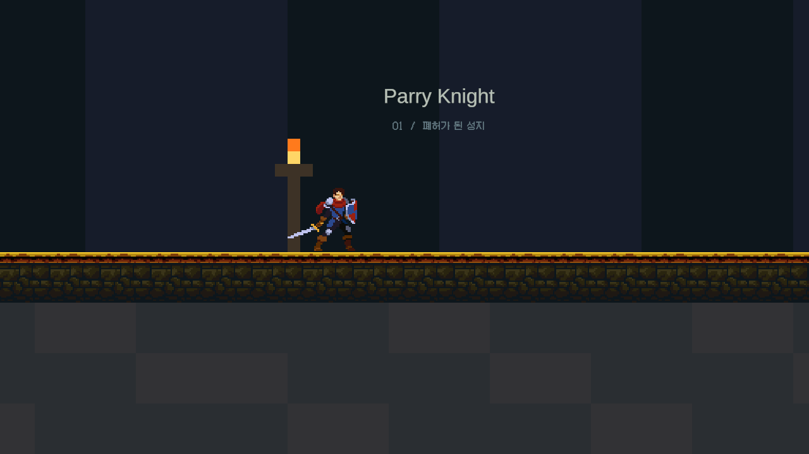

# Parry

패링과 반격을 중심으로 한 2D 횡스크롤 액션 게임입니다. 패링으로 쌓은 게이지는 일반 공격을 강화하며, 일부를 소비하면 버서커로 전환할 수 있습니다.

*Stage 01 · 폐허가 된 성지*

## 전투 기능

### 패링과 자세

패링에 성공하면 피해를 막고 적에게 반격 피해와 자세 피해를 줍니다. 자세 저항이 바닥난 적은 일시적으로 기절합니다. 일반 상태에서는 패링할 때마다 게이지가 차고, 게이지가 높을수록 일반 공격 피해가 커집니다.

### 버서커와 처형

버서커 상태에서 공격하면 적중 피해의 일부가 대상별로 저장됩니다. 패링에 성공하면 남은 시간이 늘고, 맞으면 줄어듭니다.

- **수동 종료** · 저장 피해를 연속 참격으로 발동합니다.
- **시간 만료** · 사용하지 않은 저장 피해가 사라집니다.
- **처형** · 저장 피해가 이번 타격 이후 남을 체력을 넘으면 해당 적의 참격이 즉시 발동합니다. 버서커 상태와 다른 적의 저장 피해는 유지됩니다.

### 콤보와 회피

일반 공격은 연속으로 이어 쓸 수 있습니다. 공격 도중에는 패링이나 구르기로 전환할 수 있습니다. 구르기는 기력을 소비하며 동작 중 일부 구간에 무적이 적용됩니다.

### 몬스터와 보스

적은 플레이어를 감지하면 추적하고, 거리와 패턴 조건에 맞춰 공격합니다. 보스는 한 모션 안에서 여러 차례 공격하며, 각 타격마다 피해량과 넉백, 기절 여부가 다를 수 있습니다.

## 공격 판정 편집기

- **Attack Preview** · 플레이어, 일반 몬스터, 보스의 타격 프레임을 확인하고 Scene 뷰에서 히트박스 위치와 크기를 조절할 수 있습니다.
- **Boss Attack Clip** · 한 공격 클립 안의 각 타격에 피해량, 넉백, 기절 여부를 따로 설정할 수 있습니다.
