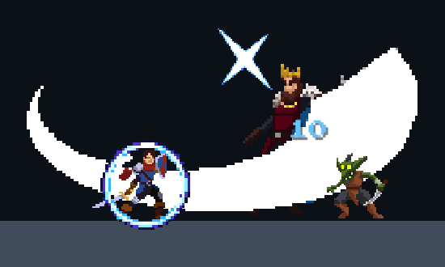
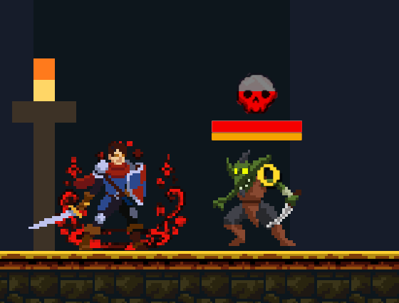
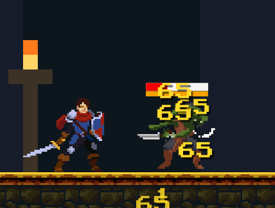
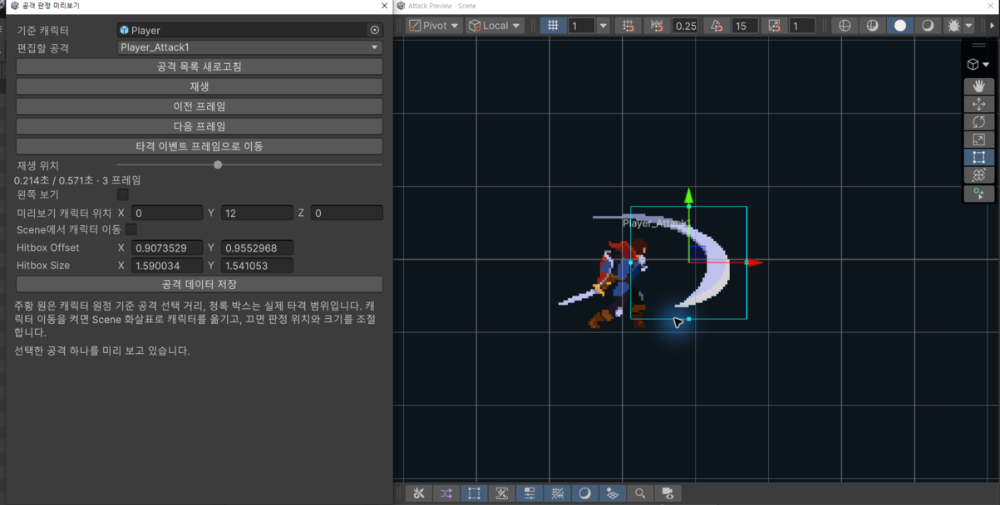
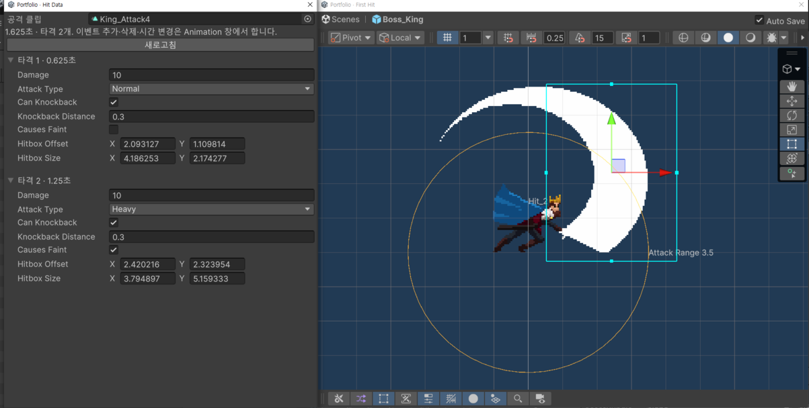

# Parry

적의 공격을 패링하고, 반격으로 자세를 무너뜨리는 2D 횡스크롤 액션 게임입니다. 패링 게이지를 유지하면 일반 공격이 강해지고, 일부를 사용하면 버서커로 전환해 적에게 참격을 쌓을 수 있습니다.

**Unity 6 · C#**

*Stage 01 · 폐허가 된 성지*

## 전투

### 패링과 반격

적의 공격 타이밍에 맞춰 패링하면 피해를 막고 즉시 반격합니다. 반격으로 적의 자세 저항을 모두 깎으면 적이 기절해 후속 공격을 넣을 수 있습니다.

일반 상태에서는 패링에 성공할 때마다 게이지가 차오릅니다. 게이지가 높을수록 일반 공격 피해가 커지며, 패링 반격에는 별도의 반격 공격력을 사용합니다.

### 콤보와 회피

일반 공격을 연속으로 이어 쓸 수 있고, 도중에 패링이나 구르기로 전환할 수 있습니다. 구르기는 기력을 소비하며 동작 중 일부 구간에만 무적이 적용됩니다. 넉백이나 넉다운이 있는 타격을 받으면 진행 중인 행동이 끊깁니다.

### 버서커와 저장 피해

패링 게이지가 충분할 때 일부를 소비해 버서커에 진입합니다. 포효가 끝나면 시간이 줄기 시작하며, 버서커 상태에서 패링에 성공하면 시간을 회복하고 피격되면 시간이 더 줄어듭니다.

버서커 공격은 직접 피해를 주면서 그 일부를 **공격한 대상에게 저장**합니다. 적 위의 처형 게이지는 남은 체력 대비 저장 피해가 얼마나 쌓였는지 보여줍니다.

| 조건 | 저장 피해 처리 |
| --- | --- |
| 버서커 수동 종료 | 대상별 저장 피해를 연속 참격으로 발동합니다. |
| 버서커 시간 만료 | 발동하지 않은 저장 피해가 사라집니다. |
| 자동 처형 | 기존 저장 피해와 이번 타격으로 저장될 피해의 합이 직접 피해 적용 후 남은 체력을 넘으면, 그 적만 즉시 처형합니다. 버서커와 다른 적의 저장 피해는 유지됩니다. |

## 몬스터와 보스

일반 몬스터는 배회하다가 플레이어를 감지하면 추적합니다. 사거리와 쿨타임에 따라 공격을 시작하고, 대상이 멀어지거나 일정 시간 시야에서 벗어나면 배회로 돌아갑니다.

보스의 연속 공격은 **한 공격 모션 안에서 여러 타격**을 처리합니다. 타격마다 피해량과 넉백, 기절 여부, 히트박스를 따로 설정할 수 있습니다. 같은 모션에서도 첫 타격과 후속 강타에 다른 반응을 줄 수 있습니다.

## 공격 판정 편집 도구

**Attack Preview**에서는 플레이어, 일반 몬스터, 보스의 공격을 선택해 타격 프레임을 확인할 수 있습니다. Scene 뷰에서 히트박스의 크기와 위치를 조정해 공격 데이터에 저장합니다. 몬스터와 보스는 패턴을 선택하는 사거리도 함께 표시합니다.

**Boss Attack Clip**에서는 한 클립의 타격 이벤트를 확인하고 각 타격의 피해량·넉백·기절 설정을 편집합니다. 아래 화면은 같은 보스 공격의 두 타격 데이터와 오른쪽의 두 번째 타격 판정을 보여줍니다.

## 전투 코드 구조

| 기능 | 구성 |
| --- | --- |
| 공격 클립 재생 | 콤보 순서는 C#에서 관리하고, 필요한 공격 클립을 Unity Playables로 재생합니다. 클립의 Animation Event가 타격 시점과 타격 데이터를 전달합니다. |
| 적 상태 머신 | 일반 몬스터와 보스는 상태 머신 실행 구조를 공유합니다. 몬스터와 보스의 Brain은 배회·추적·공격 및 각자 필요한 전용 상태를 구성합니다. |
| 피격 처리 | 공격 측은 한 번의 타격 정보를 Context로 전달합니다. 피격 대상은 자신의 방어 조건을 확인하고 피해와 반응을 처리합니다. |
